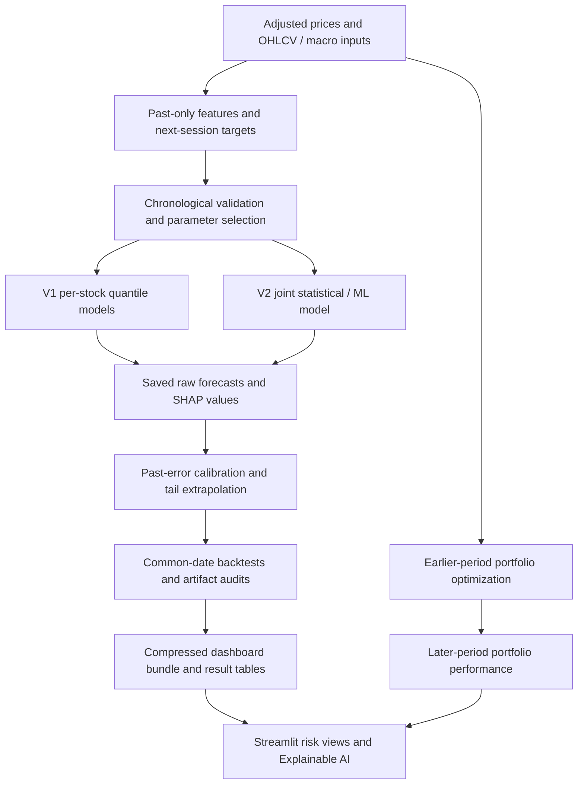

# NSE Market Risk Analytics

**Explainable machine learning for next-day stock risk forecasts and portfolio analysis.**

[Streamlit application](https://mkxk2evmghkv5rbpugw99x.streamlit.app/) · [GitHub repository](https://github.com/Virav-Shah/VaR-CVaR-Calculator-for-NSE-Stocks) · [Detailed result CSVs](results/tables/) · [Experiment record](results/experiment_record.json)

This project develops and evaluates risk forecasts for ten NSE stocks. It starts with historical, Normal and Student-t models, adds linear and LightGBM quantile regression, then tests a LightGBM model trained jointly across the ten stocks with a Student-t starting forecast. It also studies rolling forecast calibration, explains individual predictions with SHAP, and compares traditional portfolio allocation strategies.

**Main result:** at 99% confidence, the raw hybrid LightGBM model reduced average quantile forecast loss by **5.53% versus Student-t** and **8.94% versus the original LightGBM model** on the same 2,931 historical evaluation dates per stock. Adding calibration improved coverage but increased forecast loss and widened risk limits. These are retrospective results; they do not establish future superiority or production readiness.

The application and saved market data are a historical research snapshot, not a live trading or risk service. Prices end on **31 December 2025**. The original GitHub repository name is retained so the existing Streamlit URL can remain connected.

## Contents

1. [Project scope and development history](#1-project-scope-and-development-history)
2. [Risk measures and prediction target](#2-risk-measures-and-prediction-target)
3. [Data sources and preparation](#3-data-sources-and-preparation)
4. [Features and their financial meaning](#4-features-and-their-financial-meaning)
5. [Models and statistical baselines](#5-models-and-statistical-baselines)
6. [Training, validation and historical testing](#6-training-validation-and-historical-testing)
7. [Hyperparameter selection](#7-hyperparameter-selection)
8. [Training, validation and test scores](#8-training-validation-and-test-scores)
9. [Full-period V1 benchmark results](#9-full-period-v1-benchmark-results)
10. [Matched V1-to-V2 comparison](#10-matched-v1-to-v2-comparison)
11. [Rolling residual calibration](#11-rolling-residual-calibration)
12. [Expected shortfall estimation](#12-expected-shortfall-estimation)
13. [Explainable machine learning with SHAP](#13-explainable-machine-learning-with-shap)
14. [Portfolio optimization and results](#14-portfolio-optimization-and-results)
15. [Dashboard views and interpretation](#15-dashboard-views-and-interpretation)
16. [What is published in this repository](#16-what-is-published-in-this-repository)
17. [Architecture and source-code guide](#17-architecture-and-source-code-guide)
18. [Verification and reproducibility](#18-verification-and-reproducibility)
19. [Limitations and remaining work](#19-limitations-and-remaining-work)
20. [Installation, execution and deployment](#20-installation-execution-and-deployment)
21. [Conclusions supported by the evidence](#21-conclusions-supported-by-the-evidence)
22. [References and supporting reports](#22-references-and-supporting-reports)

## 1. Project scope and development history

The work covers two related tasks:

- **Stock risk forecasting:** estimate a high quantile of tomorrow's loss using information available at today's close.
- **Portfolio analysis:** estimate allocation weights from earlier data and compare the subsequent return, tail loss and drawdown of the resulting portfolios.

The portfolio optimizers use statistical optimization. They do not use the LightGBM forecasts to select weights. The stock ML experiment and the portfolio experiment also have different evaluation periods.

| Development stage | What changed | Reason | Result or practical limit |
|---|---|---|---|
| Original statistical study | Historical simulation, Normal and Student-t VaR/CVaR; numerical checks; portfolio optimization | Establish interpretable benchmarks and verify mathematical calculations | Student-t became a strong coverage benchmark; fixed-window forecasts could still have clustered breaches |
| V1 feature pipeline | Added 18 features from returns, OHLCV, NIFTY, India VIX and USD/INR | Forecast conditional risk rather than using only an unconditional rolling loss distribution | Features support changing market conditions; complete observations start later than the closing-price history |
| V1 linear and LightGBM models | Separate models per stock, six quantiles, chronological tuning and rolling refits | Compare a simple regularized model with nonlinear ML | Raw LightGBM undercovered at 99%; linear regression performed worse on the reported tail diagnostics |
| Backtest corrections | Stable likelihood calculations, explicit undefined tests, common forecast dates and actual latest-250 counts | Avoid numerical failures and misleading comparisons | Diagnostics handle zero/all breaches and missing transition states more honestly |
| Joint training across stocks | Combined ten stocks after volatility scaling | Share patterns across assets and increase the number of observations per fit | 7,500 rows per fit; correlated stocks still share market crashes |
| Hybrid statistical/ML model | Student-t VaR anchors plus learned residual quantiles | Give the ML model a statistical starting point | Raw V2 improved average pinball loss at both reported confidence levels |
| Calibration experiment | Added a signed adjustment based on the previous 250 errors | Test whether repeated risk underestimation could be corrected | Coverage improved; larger limits and worse forecast loss show that the extra layer has a cost |
| Revised ES extrapolation | Matched a Student-t tail to the 95% and 99% forecasts | Remove V1's flat tail above 99.5% | Produces an explicit parametric ES proxy; true extreme-loss accuracy remains unproven |
| Explainable AI | Saved SHAP contributions from each forecast's model | Make the risk estimate inspectable and numerically reconstructible | V1 and V2 have top-five explanations; SHAP does not explain the cause of a crash |
| Portfolio corrections | Removed cutoff overlap, tightened minimum-variance convergence, used comparable simple-return performance and fractional tail weighting | Make portfolio comparisons consistent | Optimized portfolios reduced some losses but also gave up return; minimum CVaR was not best on every test metric |
| Deployment and presentation | Published compressed forecasts/explanations, removed online SHAP dependency, simplified to five tabs and analytical headings | Run the research dashboard from a clean checkout without retraining | Cloud uses saved output data; full local training artifacts remain separate |

## 2. Risk measures and prediction target

### Value at Risk and Expected Shortfall

**Value at Risk (VaR)** is a loss threshold at a chosen confidence level. A correctly calibrated 99% VaR should be exceeded on approximately 1% of observations over an appropriate evaluation period. A breach can still be much larger than the threshold.

**Expected Shortfall (ES), also called CVaR**, measures average loss in the tail beyond the chosen quantile under the assumed or empirical loss distribution. It addresses tail severity rather than just the boundary of the tail.

For example, a 99% VaR of 4% is a risk boundary, not a guarantee that losses cannot exceed 4%. ES might be higher because it summarizes the severity of the worst outcomes.

### Target, forecast origin and units

For stock price `P`:

```text
r[t] = log(P[t] / P[t-1])
Loss[t+1] = -log(P[t+1] / P[t])
Forecast made at close t: quantile_alpha(Loss[t+1] | information through t)
```

Positive loss means a price decline. Features are indexed by forecast origin `t`. Saved forecasts are indexed by the **realization date** `t+1`, with `Origin` retained separately where applicable. The last usable origin is 2025-12-30; its target is the return realized on 2025-12-31.

Stock-model VaR, ES and SHAP values use **log-loss units**. Multiplying a value by 100 expresses it as percentage log loss. For small moves that is close to the ordinary percentage loss, but the two differ for large moves: ordinary loss corresponding to log loss `L` is `1 - exp(-L)`. Portfolio performance instead aggregates constituent **simple returns** before compounding.

### Forecast objective: pinball loss

The models estimate quantiles, so the central forecast score is pinball loss:

```text
u = realized_loss - predicted_quantile
rho_alpha(u) = u * (alpha - 1{u < 0})
```

At 99%, an underestimated loss receives weight 0.99 and an overestimated loss receives weight 0.01. This balances tail protection against excessively large forecasts. Lower average pinball loss is better. This is a quantile regression task: classification accuracy, F1 and R² are not the primary selection metrics used here.

## 3. Data sources and preparation

### Universe

| NSE ticker | Company | Sector represented |
|---|---|---|
| `BHARTIARTL.NS` | Bharti Airtel | Telecom |
| `HDFCBANK.NS` | HDFC Bank | Private banking |
| `HINDUNILVR.NS` | Hindustan Unilever | Consumer goods |
| `ICICIBANK.NS` | ICICI Bank | Private banking |
| `INFY.NS` | Infosys | IT services |
| `ITC.NS` | ITC | Consumer businesses |
| `LT.NS` | Larsen & Toubro | Engineering and infrastructure |
| `RELIANCE.NS` | Reliance Industries | Energy and diversified businesses |
| `SBIN.NS` | State Bank of India | Public-sector banking |
| `TCS.NS` | Tata Consultancy Services | IT services |

This is a selected surviving stock universe, not a historical reconstruction of every stock that an investor could have held.

### Sources and retained observations

| Input | Source or identifier | Use |
|---|---|---|
| Adjusted daily closing prices | Yahoo Finance through `yfinance`, `auto_adjust=True` | Returns and untrimmed next-session targets |
| Adjusted OHLCV | The same stock symbols, separately cached | Intraday-range and volume features |
| NIFTY 50 | `^NSEI` | Rolling market beta and correlation |
| India VIX | `^INDIAVIX` | Expected-volatility level and change features |
| USD/INR | `INR=X` | Lagged foreign-exchange return feature |

**India VIX means India Volatility Index.** NSE derives it from NIFTY option prices to reflect expected market volatility over the next 30 calendar days, quoted as an annualized percentage. Higher readings indicate larger expected fluctuations; they do not predict market direction. [NSE definition](https://www.nseindia.com/static/products-services/indices-indiavix-index).

| Data quantity | Recorded snapshot |
| --- | --- |
| Closing-price history | 2006-01-02–2025-12-31 |
| Daily price dates | 4,933 |
| Stock columns | 10 |
| Missing closing-price cells | 0 |
| Daily return dates | 4,932 |
| Usable ML origins per stock | 4,316 |
| Usable ML origin dates | 2008-06-06–2025-12-30 |
| Joint V2 panel rows | 43,160 |
| Raw realized OOS dates per stock / across stocks | 3,181 / 31,810 |
| Post-calibration-warm-up comparison dates per stock / across stocks | 2,931 / 29,310 |

The closing-price CSV contains no missing cells in this snapshot. However, not every price date has a usable complete set of macro, OHLCV and rolling features. Complete-case ML history therefore starts on **2008-06-06**, with **4,316 usable origins per stock**, rather than using the full price history from 2006.

### Preparation and information timing

1. Preserve the existing adjusted closing-price cache rather than silently replacing it during feature downloads.
2. Remove duplicate dates and all-empty rows in the downloader; flag daily moves above 20% and runs of at least five zero returns for review. These checks flag observations; they do not establish that a flagged move is erroneous.
3. Build features on the equity calendar using only current or earlier values. Drop incomplete feature/target rows. Do not fill from future observations.
4. Align macro series and forward-fill missing aligned values for at most two equity sessions. Do not forward-fill equity OHLCV in the feature loader.
5. Lag USD/INR by one available observation before alignment because its daily bar can finish after the NSE close. India VIX and NIFTY values are assumed available after their NSE close.
6. Retain the original extreme returns and loss targets. They are not clipped or winsorized to make the tail easier to predict.

These are causal alignment rules in the code, not a complete point-in-time market-data system. Actual vendor release latency, corporate-action adjustment vintages and historical revisions remain limitations. The separately downloaded OHLCV cache can have a different adjustment vintage from the original price CSV.

## 4. Features and their financial meaning

### The 18 original ML features

At origin `t`, a window includes data through `t`. `r` is the stock's log return; `m` is the NIFTY log return. Rolling standard deviations use the pandas sample convention.

| Feature column | Construction | What it describes | V2 scaling |
|---|---|---|---|
| `vol_5` | Standard deviation of the last 5 returns | Recent volatility | Divide by 20-session volatility |
| `vol_21` | Standard deviation over 21 sessions | Approximately one trading month's volatility | Divide by 20-session volatility |
| `vol_63` | Standard deviation over 63 sessions | Approximately one quarter's volatility | Divide by 20-session volatility |
| `vol_ratio` | `vol_5 / vol_63` | Short-term volatility relative to its longer-run level | Retain ratio |
| `parkinson_21` | Square root of mean squared `log(high/low)` divided by `4*log(2)`, over 21 sessions | Intraday price-range volatility | Divide by 20-session volatility |
| `downside_21` | Mean of `min(r,0)^2` over 21 sessions | Recent downside second moment | Divide by squared 20-session volatility |
| `skew_63` | Rolling skewness over 63 sessions | Return asymmetry | Retain |
| `kurt_63` | Rolling pandas excess kurtosis over 63 sessions | Frequency/severity of extreme returns | Retain |
| `abs_return` | `abs(r[t])` | Size of the latest move | Divide by 20-session volatility |
| `down_return` | `min(r[t],0)` | Latest negative return, or zero | Divide by 20-session volatility |
| `dispersion` | Cross-sectional standard deviation of all ten returns that day | Differences in stock performance across the universe | Divide by this stock's 20-session volatility |
| `beta_21` | Rolling covariance of stock/NIFTY returns divided by NIFTY variance | Sensitivity to market movements | Retain |
| `correlation_21` | Rolling stock/NIFTY correlation | Market co-movement | Retain |
| `vix_z_63` | Log India VIX relative to its 63-session rolling mean and standard deviation | Expected volatility relative to recent history | Retain z-score |
| `vix_change_5` | Five-session difference in log India VIX | Recent change in expected volatility | Retain log change |
| `volume_z_21` | Volume relative to its 21-session mean and standard deviation | Unusual trading activity | Retain z-score |
| `fx_return` | One-session log change in the already-lagged USD/INR series | Recent currency movement available to the forecast | Retain log return |
| `momentum_5` | Sum of the last 5 stock log returns | Recent price trend | Divide by 20-session volatility |

Raw stock price levels are not model inputs. Forecast dates, future losses, target dates and model block IDs are metadata, not predictive features.

### V2 additions: 31 features in total

V2 retains the 18 original columns with the scaling above, then adds:

| Added columns | Count | Purpose |
|---|---:|---|
| `student_t_var_0.95_norm`, `student_t_var_0.99_norm` | 2 | Historical Student-t risk boundaries divided by origin volatility |
| `inverse_student_df` | 1 | `1/nu`, representing the fitted statistical tail's heaviness |
| `stock_BHARTIARTL`, `stock_HDFCBANK`, `stock_HINDUNILVR`, `stock_ICICIBANK`, `stock_INFY`, `stock_ITC`, `stock_LT`, `stock_RELIANCE`, `stock_SBIN`, `stock_TCS` | 10 | One-hot stock identities, permitting stock-specific adjustments |

Total: **18 + 2 + 1 + 10 = 31 features**.

The origin volatility is `sigma[t] = std(r[t-19:t])`. It is known when the forecast is made. Scaling uses the origin's volatility, never a volatility estimate measured after the target loss. This puts differently volatile stocks on a more comparable scale without treating their returns as identical.

## 5. Models and statistical baselines

| Model | Inputs and fit | Output | Role |
|---|---|---|---|
| Historical simulation | Previous 250 stock losses | Empirical quantile and exceedance-average ES | Distribution-free-in-form benchmark, with finite-sample limitations |
| Normal | Mean and sample standard deviation of the previous 250 returns | Analytical Normal VaR and ES | Simple thin-tail benchmark |
| Student-t | Maximum-likelihood fit on 250 historical returns, refreshed every five sessions | Parametric VaR and ES | Strong statistical benchmark and V2 anchor |
| Linear V1 | 18 features; separate stock/quantile regressions; training-only StandardScaler; L1 penalty | Six conditional loss quantiles | Interpretable regularized ML reference |
| LightGBM V1 | 18 features; separate stock/quantile boosted trees | Six conditional loss quantiles | Original nonlinear ML model |
| V1 + calibration | Saved V1 forecasts plus past forecast errors | Corrected 95% and 99% boundaries and revised ES proxy | Calibration-only ablation without retraining V1 |
| Joint hybrid LightGBM V2 | 31 features across ten stocks; normalized residual targets around Student-t | 95% and 99% quantiles | Shared statistical/ML forecasting model |
| V2 + calibration | Raw V2 forecasts plus past forecast errors | Corrected boundaries and revised ES proxy | Tests the extra calibration layer |

V1 fits quantiles **0.95, 0.96, 0.97, 0.98, 0.99 and 0.995**. V2 fits **0.95 and 0.99**. Predictions are sorted row by row to avoid crossing, so a higher confidence level never receives a smaller final boundary. Equal quantiles are allowed.

### Hybrid target and reconstruction

For each confidence level `a`, V2 learns a quantile of the normalized residual:

```text
residual_target[a] = (Loss[t+1] - Student_t_VaR[a,t]) / sigma[t]
raw_VaR[a,t] = Student_t_VaR[a,t] + sigma[t] * ML_residual_quantile[a,t]
```

The Student-t quantiles also appear in the model inputs. Their SHAP contribution describes how the statistical state changes the learned correction, while the statistical starting value is shown separately in the full reconciliation.

This method learns from all training rows under a quantile objective; it does not train only on the few observed crash days. A fit contains **750 dates × 10 stocks = 7,500 rows**, but co-moving stocks do not provide 7,500 independent market observations.

### Numerical and mathematical checks

The original analytical components remain available: VaR through pinball minimization, Normal and Student-t CDF root finding, an alternative Student-t likelihood optimizer, the single-asset Rockafellar–Uryasev objective, and the portfolio CVaR linear program. These check mathematical consistency; they are not additional trained AI models.

The inherited Student-t benchmark changes fitted `nu <= 2` to `2.1` and keeps the fitted location and scale. This is a numerical/variance safeguard, not a constrained maximum-likelihood refit. ES requires `nu > 1`; finite variance requires `nu > 2`. The hybrid preserves this exact benchmark behavior for a fair starting point.

## 6. Training, validation and historical testing

### Chronological design

The project uses rolling windows rather than a random split of financial observations. The initial origin sequence is:

```text
750 training origins | 5-origin purge | 375 validation origins | 5-origin purge | OOS forecasts
                                        3 blocks of 125 origins
```

In zero-based positions, the first training window is `0:750`, validation occupies `755:1130`, and the first OOS forecast origin is position `1135`. The first validation window is not the only training window: training rolls forward between validation blocks.

| Fold | Training origins: start | Training origins: end | Last training label | Validation origins: start | Validation origins: end |
| --- | --- | --- | --- | --- | --- |
| 1 | 2008-06-06 | 2011-07-12 | 2011-07-13 | 2011-07-20 | 2012-01-23 |
| 2 | 2009-01-02 | 2012-01-16 | 2012-01-17 | 2012-01-24 | 2012-07-24 |
| 3 | 2009-07-10 | 2012-07-17 | 2012-07-18 | 2012-07-25 | 2013-01-29 |

Dates in that table are **feature/forecast origins**. Each origin predicts the following equity session. For V1, each validation fit has 750 stock rows and each validation block has 125 rows. V2 assigns all stocks from a date together: each fit has 7,500 rows and each validation block has 1,250 rows, for 3,750 validation predictions across the three blocks.

### How the three stages are used

1. **Training within each validation fold:** fit the scaler, if applicable, and the quantile models using the trailing training window.
2. **Validation:** evaluate on the subsequent block after the five-origin gap. Use these scores for the ten-trial parameter search and LightGBM early stopping.
3. **Freeze settings:** retain selected hyperparameters and the median best iteration count from the winning trial's fold/quantile models.
4. **Historical OOS refits:** use those frozen settings, refit on the latest eligible 750 dates, and predict the next 60 origins. Repeat for 54 blocks; the last block contains one date.
5. **Score realized forecasts:** compare each prediction with its next-session loss using consistent dates and units.

The first frozen OOS fit uses origins **2010-01-20 through 2013-01-29**. Its latest training label is **2013-01-30**; its first test origin is **2013-02-06**, forecasting the loss realized on **2013-02-07**. The code asserts that training labels precede the first test origin.

The historical forecast period is **2013-02-07–2025-12-31**, containing **3,181 realized forecasts per stock**. Advancing refits can use earlier test-period outcomes once those outcomes have become historical. This simulates an adaptive forecasting procedure; it is not a single model fitted once in 2013 and held fixed until 2025.

Earlier validation outcomes can also enter later training windows after parameter selection. Thus this is a sequence of chronological fits, not three permanently disjoint random datasets. The five-origin purge separates labels and forecast information sets; it does not eliminate all dependence from overlapping 63-session feature lookbacks.

### Leakage controls and their limits

- Current-close features forecast only the next session.
- Linear scaling is fitted on training rows only.
- The rolling volatility, Student-t anchors and macro transformations use available history.
- V2 splits entire dates together, preventing stocks from the same date being divided across training and validation/test sets.
- Target columns and target dates are excluded from the input feature schema.
- Hyperparameters are not retuned on the reported OOS comparison period.
- Calibration shifts errors by one realized observation before taking the rolling statistic.
- Full extreme target losses are retained for fitting and evaluation.

**Important design limitation:** V1's historical results informed the V2 redesign. Individual V2 forecasts obey chronological information constraints, but the overall design has already seen the evaluation outcomes. V2 is therefore a **retrospective research benchmark**, not a completely untouched final test. A future study should freeze the design before collecting genuinely unseen data.

## 7. Hyperparameter selection

Each V1 stock has one linear and one LightGBM study. Each study uses ten trials, three rolling validation folds and seed 42. V2 has one joint ten-trial study over the same date structure. This produces **210 recorded trials** across 21 studies. Optuna uses a seeded `TPESampler`; ten trials provide a small search budget, not an exhaustive optimization exercise.

| Parameter | Linear V1 | LightGBM V1 | Hybrid LightGBM V2 |
|---|---|---|---|
| Objective | Quantile loss with L1 regularization | Quantile loss | Quantile loss on normalized residuals |
| Quantile levels | Six levels from .95 to .995 | Six levels from .95 to .995 | .95 and .99 |
| L1 penalty | Log-uniform search, `1e-6` to `1e-3` | — | — |
| Maximum tree depth | — | 2–4 | 2–4 |
| Leaves | — | 4 to `min(15, 2^depth)` | Same depth-compatible range |
| Minimum observations per leaf | — | 30–100 | 300–1,000 |
| Learning rate | — | Log search, .01–.08 | Log search, .01–.06 |
| Estimator upper limit in search | — | 100–400 | 80–250 |
| Row sampling | — | .6–.9; sample every boosting iteration | Fixed .8; sample every boosting iteration |
| Feature sampling | — | .6–.9 | Fixed .9 |
| Early-stopping patience | — | 25 rounds | 20 rounds |
| Execution | CPU, HiGHS linear solver | CPU, two workers | CPU, two workers |

The V1 selection objective averages pinball loss over six quantiles and all validation rows. The V2 objective averages two quantiles after dividing forecast errors by origin volatility. Every V2 date has ten stocks, so dates have equal total weight.

The larger V2 leaf-size range limits complexity relative to the larger row count, but it does not itself correct for correlated stock observations.

### Selected V2 configuration

```json
{
  "max_depth": 2,
  "num_leaves": 4,
  "min_child_samples": 340,
  "learning_rate": 0.047208048834382316,
  "n_estimators": 34,
  "subsample": 0.8,
  "subsample_freq": 1,
  "colsample_bytree": 0.9,
  "random_state": 42,
  "n_jobs": 2,
  "device_type": "cpu"
}
```

The winning V2 trial searched an upper limit of 182 estimators. The median early-stopping result selected **34** for subsequent refits. During OOS refits there is no early stopping against future test outcomes.

V1 settings differ by stock. Full selected parameters are recorded in the `FrozenParameters` column of [model development scores](results/tables/model_development_scores.csv) and in [the experiment record](results/experiment_record.json). All trial parameters, scores, selected flags and frozen iteration counts are published in [validation_trials.csv](results/tables/validation_trials.csv).

Using the same validation folds for parameter selection, early stopping and reporting the winning validation score introduces selection optimism. There is no nested outer tuning study here. Reported validation performance should be interpreted accordingly.

## 8. Training, validation and test scores

### What these scores actually measure

There were no saved per-iteration training-loss curves. To document training performance, `scripts/summarize_experiments.py` loads the **first serialized OOS refit** for each model and predicts its own training rows. It does not retrain the model. These are **reconstructed in-sample diagnostics**, not independent validation scores or averages over every historical refit's training set.

- **First-refit training score:** average pinball loss on that frozen model's training window, 2010-01-20–2013-01-29.
- **Best validation score:** the logged winning objective over the three earlier rolling validation folds.
- **Full OOS score:** average pinball loss over all 3,181 realized OOS dates per stock, before excluding calibration warm-up.

| Model | Aggregation | Score units / native quantile objective | First-refit train | Best validation | Full OOS |
| --- | --- | --- | --- | --- | --- |
| Linear V1 | Mean of 10 stock models | log loss | 0.000962783 | 0.001284125 | 0.001256993 |
| LightGBM V1 | Mean of 10 stock models | log loss | 0.000916906 | 0.001081932 | 0.001145185 |
| Pooled hybrid V2 | One joint model | volatility-normalized loss | 0.075795955 | 0.078643100 | 0.081548520 |

**Do not compare V1's score magnitudes directly with V2's.** V1 uses log-loss units and six quantiles; V2 uses volatility-normalized loss and two quantiles. The comparable 95% and 99% results in Section 10 return all models to log-loss units and identical evaluation dates.

The training, validation and historical OOS periods also have different market conditions. Their difference is not a clean causal measure of overfitting. Validation uses fold-specific early stopping, whereas the reconstructed training diagnostic uses the frozen median iteration count and a later training window.

### LightGBM V1 by stock

Each row averages the same six quantiles. Scores use log-loss units. Training contains 750 rows; full OOS contains 3,181 rows. Trial IDs are zero-based.

| Stock | First-refit train | Best validation | Full OOS | Selected trial | Final trees |
| --- | --- | --- | --- | --- | --- |
| BHARTIARTL | 0.001062683 | 0.001232120 | 0.001180787 | 9 | 36 |
| HDFCBANK | 0.000723021 | 0.000808862 | 0.001011739 | 1 | 64 |
| HINDUNILVR | 0.000743574 | 0.000849801 | 0.000899159 | 9 | 40 |
| ICICIBANK | 0.000939849 | 0.001033071 | 0.001333884 | 7 | 66 |
| INFY | 0.001105482 | 0.001425517 | 0.001233912 | 1 | 23 |
| ITC | 0.000852756 | 0.000918467 | 0.001084198 | 1 | 16 |
| LT | 0.000920069 | 0.001099308 | 0.001209076 | 3 | 72 |
| RELIANCE | 0.000721031 | 0.000993858 | 0.001146247 | 9 | 88 |
| SBIN | 0.001074182 | 0.001245859 | 0.001327957 | 9 | 26 |
| TCS | 0.001026408 | 0.001212458 | 0.001024895 | 7 | 8 |

### Linear V1 by stock

The same date and quantile definitions apply. The regularization value is the selected L1 coefficient after training-only standardization.

| Stock | First-refit train | Best validation | Full OOS | Selected trial | L1 coefficient |
| --- | --- | --- | --- | --- | --- |
| BHARTIARTL | 0.001137784 | 0.001482163 | 0.001278588 | 1 | 0.0007114 |
| HDFCBANK | 0.000775298 | 0.000884626 | 0.001028796 | 1 | 0.0007114 |
| HINDUNILVR | 0.000809983 | 0.001025158 | 0.001072013 | 7 | 0.0003968 |
| ICICIBANK | 0.001027766 | 0.001201150 | 0.001227370 | 1 | 0.0007114 |
| INFY | 0.001078658 | 0.001718960 | 0.001342657 | 1 | 0.0007114 |
| ITC | 0.000833519 | 0.001084476 | 0.001284717 | 1 | 0.0007114 |
| LT | 0.001020951 | 0.001371704 | 0.001663086 | 1 | 0.0007114 |
| RELIANCE | 0.000883599 | 0.001179464 | 0.001190315 | 1 | 0.0007114 |
| SBIN | 0.001121956 | 0.001352834 | 0.001435311 | 1 | 0.0007114 |
| TCS | 0.000938311 | 0.001540718 | 0.001047072 | 1 | 0.0007114 |

### Reading the development scores

The nonlinear V1 model had a lower mean validation objective than the linear reference. That did not solve 99% coverage: a model can improve an average quantile objective while still underestimating a particular tail. V2's reconstructed training score is lower than its validation and full OOS normalized scores; that is plausible for in-sample fitting, but it is not proof that future risk is calibrated.

The score tables are exported rather than inferred from a screenshot. [model_development_scores.csv](results/tables/model_development_scores.csv) contains all 21 model/study rows, exact dates, row counts, score units and frozen parameters. [validation_folds.csv](results/tables/validation_folds.csv) and [pooled_training_folds.csv](results/tables/pooled_training_folds.csv) provide the temporal boundaries.

## 9. Full-period V1 benchmark results

The original ML comparison evaluates **3,181 matched sessions per stock, 2013-02-07–2025-12-31**. It includes linear regression and all three statistical benchmarks. Counts below are stocks with test p-values greater than .05, out of ten. Undefined tests are not counted as passing.

| Confidence | Model | Coverage passes | Independence passes | Mean breach rate | Mean pinball loss |
| --- | --- | --- | --- | --- | --- |
| 95% | Historical | 10/10 | 4/10 | 5.335% | 0.00186699 |
| 95% | Normal | 2/10 | 4/10 | 4.068% | 0.00187307 |
| 95% | Student-t | 10/10 | 2/10 | 4.728% | 0.00186078 |
| 95% | Linear V1 | 0/10 | 0/10 | 8.104% | 0.00217339 |
| 95% | LightGBM V1 | 5/10 | 7/10 | 5.942% | 0.00186222 |
| 99% | Historical | 5/10 | 7/10 | 1.386% | 0.00062517 |
| 99% | Normal | 2/10 | 7/10 | 1.471% | 0.00062183 |
| 99% | Student-t | 10/10 | 6/10 | 1.031% | 0.00062218 |
| 99% | Linear V1 | 0/10 | 5/10 | 2.270% | 0.00067106 |
| 99% | LightGBM V1 | 3/10 | 8/10 | 1.682% | 0.00064414 |

At 99%, Student-t achieved ten coverage passes and six independence passes. LightGBM V1 achieved three coverage passes and eight independence passes, with 1.682% average breaches against a 1% target. The linear reference undercovered more strongly. V1 therefore supported a useful diagnosis: nonlinear features alone did not provide enough reliable extreme-tail calibration at the original per-stock sample size.

Source: [backtest_results.csv](results/tables/backtest_results.csv). These full-period results must not be mixed with the shorter calibrated comparison below.

## 10. Matched V1-to-V2 comparison

### Why the evaluation starts later

Calibration needs 250 previously realized raw forecast errors. Its first 250 predictions are warm-up observations, not scored calibrated forecasts. For fairness, **all five versions**, including raw V1, raw V2 and Student-t, are evaluated only on the same remaining **2,931 dates per stock: 2014-02-11–2025-12-31**.

That is why, for example, V1's 99% independence count is 10/10 in this table but 8/10 in the full-period V1 table. Neither number is substituted for the other; they use different periods.

The matched data contain 29,310 stock-date outcomes per version. Macro-average scores give equal weight to the ten stocks, each of which has the same number of dates.

### 99% forecasts: target breach rate 1%

| Version | Coverage | Independence | Both | Mean breach rate | Mean VaR | Mean ES | Mean pinball loss |
| --- | --- | --- | --- | --- | --- | --- | --- |
| Student-t baseline | 10/10 | 6/10 | 6/10 | 0.986% | 4.308% | 6.008% | 0.00061415 |
| LightGBM V1 | 3/10 | 10/10 | 3/10 | 1.614% | 3.713% | 4.265% | 0.00063715 |
| V1 + calibration | 10/10 | 9/10 | 9/10 | 0.805% | 4.945% | 7.280% | 0.00062719 |
| Pooled hybrid V2 | 9/10 | 10/10 | 9/10 | 1.088% | 4.055% | 5.604% | 0.00058019 |
| V2 + calibration | 10/10 | 9/10 | 9/10 | 0.925% | 4.961% | 7.344% | 0.00063098 |

### 95% forecasts: target breach rate 5%

| Version | Coverage | Independence | Both | Mean breach rate | Mean VaR | Mean ES | Mean pinball loss |
| --- | --- | --- | --- | --- | --- | --- | --- |
| Student-t baseline | 9/10 | 2/10 | 2/10 | 4.558% | 2.482% | 3.702% | 0.00183337 |
| LightGBM V1 | 7/10 | 6/10 | 4/10 | 5.841% | 2.258% | 3.093% | 0.00183609 |
| V1 + calibration | 10/10 | 8/10 | 8/10 | 4.828% | 2.506% | 4.145% | 0.00181720 |
| Pooled hybrid V2 | 10/10 | 7/10 | 7/10 | 5.049% | 2.386% | 3.500% | 0.00178607 |
| V2 + calibration | 10/10 | 6/10 | 6/10 | 4.933% | 2.532% | 4.173% | 0.00181724 |

### Interpretation

- **Raw hybrid V2:** mean pinball loss improved by **5.53% at 99%** and **2.58% at 95%** versus Student-t. At 99% it also improved **8.94% versus raw V1**. These are descriptive relative reductions in average pinball loss, not a 5.53-percentage-point accuracy gain or a statistical significance claim.
- **Calibrated V2:** 99% coverage passed for all ten stocks, but average VaR rose from approximately **4.05% to 4.96% log loss**, an increase of about **22.3%** over raw V2. Its pinball loss rose about **8.8%** over raw V2 and was about **2.7% higher than Student-t**.
- **Calibration was not uniformly helpful:** at 95%, it also worsened V2's average pinball loss and reduced independence passes from seven to six.
- **A simple alternative remains competitive:** V1 plus calibration produced nine stocks passing both component tests at 99%, the same count as calibrated V2. More ML complexity is not justified by that count alone.
- **Test passes are limited evidence:** p > .05 means the particular test did not reject its null. It does not establish safe forecasts, guaranteed coverage or regulatory approval. Both-pass counts require both component tests for the same stock; they are not a separate certification.

### Per-stock raw V2 results at 99%

| Stock | Breach rate | Pinball loss | Coverage p-value | Independence p-value |
| --- | --- | --- | --- | --- |
| BHARTIARTL | 0.989% | 0.00056573 | 0.9540 | 0.4464 |
| HDFCBANK | 1.126% | 0.00051498 | 0.5019 | 0.3873 |
| HINDUNILVR | 0.887% | 0.00044828 | 0.5310 | 0.4950 |
| ICICIBANK | 1.058% | 0.00063344 | 0.7559 | 0.3387 |
| INFY | 1.399% | 0.00068219 | 0.0407 | 0.6048 |
| ITC | 1.024% | 0.00061457 | 0.8985 | 0.3154 |
| LT | 0.955% | 0.00059410 | 0.8064 | 0.4623 |
| RELIANCE | 1.160% | 0.00057052 | 0.3958 | 0.4126 |
| SBIN | 1.126% | 0.00065626 | 0.5019 | 0.3873 |
| TCS | 1.160% | 0.00052184 | 0.3958 | 0.3716 |

INFY remains a coverage failure, with about **1.399% breaches** and Kupiec p ≈ **0.0407**. Calibrated V2 resolves its coverage failure in this period, but **ITC still fails independence**, p ≈ **0.0147**. No model version passes every displayed criterion for every stock.

All 100 stock/version/confidence rows, including conditional coverage, breach severity, ES ratio and latest-250 traffic-light diagnostics, are in [v1_v2_comparison.csv](results/tables/v1_v2_comparison.csv). Aggregate results are in [v1_v2_summary.csv](results/tables/v1_v2_summary.csv).

### What the backtest metrics mean

| Metric | Question addressed | Important limit |
|---|---|---|
| Breach rate | How often did realized loss exceed VaR? | Correct average frequency can conceal crisis clusters |
| Kupiec coverage test | Is the overall breach count inconsistent with the target frequency? | A pass does not prove calibration; power is limited in rare tails |
| Christoffersen independence test | Is there evidence of dependence in consecutive breach indicators? | It is a first-order transition diagnostic, not proof of complete independence |
| Conditional coverage test | Are frequency and first-order independence jointly consistent with the model? | It inherits limitations and undefined cases from the components |
| Pinball loss | How costly were quantile errors, accounting for confidence level? | Must compare the same units, dates and quantiles |
| Mean VaR | How large were risk limits on average? | Higher limits alone do not establish better predictions |
| Breach severity | How far did losses exceed the boundary on breach days? | Based on a small, model-dependent subset of dates |
| ES ratio | Were realized breach losses close to predicted ES on those dates? | Diagnostic only; different models can select different breach days |
| Basel-style last-250 zone | How many 99% exceptions occurred over the latest 250 valid forecasts? | Historical diagnostic only; not a regulatory capital calculation or approval |

Coverage likelihoods are computed in log space so zero/all-breach edge cases remain numerically valid. Independence is undefined if a transition state is unobserved; undefined values remain missing rather than passing by default.

## 11. Rolling residual calibration

For each stock and confidence level, define the standardized error of the **raw** forecast:

```text
e[s] = (realized_loss[s] - raw_VaR[s]) / origin_volatility[s]
buffer[d] = origin_volatility[d] * order_statistic(previous 250 e, ceil(251*alpha))
calibrated_VaR[d] = raw_VaR[d] + buffer[d]
```

The selected rank is **239 at 95%** and **249 at 99%**, counting from one. At 99%, this is the second-largest error among 250 observations, illustrating how coarse a one-year extreme-tail estimate can be. The implementation shifts errors by one before rolling, so today's realized loss cannot enter today's adjustment. Quantile sorting is applied again after calibration, with any resulting change stored separately.

The buffer is signed: it can raise an optimistic forecast or lower a consistently excessive one. It is calculated from raw errors, not errors from already corrected predictions, avoiding a feedback definition that changes the intended residual distribution. Both V1 and V2 use the same 250-session design. V1's underlying models are not retrained for this experiment.

This is a **rolling conformal-style residual correction**, not the adaptive conformal inference algorithm or a distribution-free guarantee for dependent financial returns. It is sensitive to a few extreme errors in a 250-day window, especially at 99%. Its empirical coverage improvement must be assessed together with forecast loss and capital conservatism. The design does not tune buffers to force a Kupiec pass.

## 12. Expected shortfall estimation

### V1: a finite quantile-grid estimate

V1 integrates the piecewise-linear quantile curve from the chosen confidence to .995, then assumes the .995 quantile stays constant to probability one:

```text
ES[a] = (integral from a to .995 of interpolated_quantile(u) du
         + (1-.995)*quantile(.995)) / (1-a)
```

This improves on simply averaging unevenly spaced quantiles. However, a flat terminal tail can understate extreme losses. At 99%, half of the relevant tail probability lies above .995. V1's original values remain in its raw comparison row so the change is visible.

### V2 and the calibrated variants: explicit Student-t extrapolation

Use the historical fitted degrees of freedom `nu`, but infer one loss distribution's location and scale from the final ordered 95% and 99% boundaries:

```text
z95 = t_inverse_cdf(.95, nu)
z99 = t_inverse_cdf(.99, nu)
scale = (q99 - q95) / (z99 - z95)
location = q95 - scale*z95
ES[a] = location + scale*t_pdf(z[a], nu)*(nu + z[a]^2)/((1-a)*(nu-1))
```

This accounts for nonzero location and extrapolates beyond .995. A fixed formula such as `ES = 1.2*VaR` is not generally valid because the ratio also depends on confidence, degrees of freedom and location. Equal calibrated quantiles imply a zero-scale limiting distribution; that is allowed mathematically but should be monitored as a possible sign of lost tail information.

**This is a parametric ES proxy.** Two correct-looking quantiles do not identify the true extreme tail. Student-t symmetry, degrees-of-freedom estimation and calibration uncertainty can all distort the extrapolation.

At 99%, the mean per-stock realized/predicted ES ratio is approximately **1.299 for raw V1**, **1.038 for raw V2**, **1.053 for Student-t** and **1.045 for calibrated V2**. Closeness to one is encouraging, but each model selects its own breach days. These are not formal ES validation results, and the project does not claim that ES is now empirically proven correct.

## 13. Explainable machine learning with SHAP

### Purpose and calculation

SHAP, short for **SHapley Additive exPlanations**, assigns feature contributions to a model output relative to an expected-output reference. Here it answers: **which inputs raised or lowered this particular 99% risk forecast?** It does not identify which inputs caused the subsequent market loss.

Tree SHAP is calculated offline using the exact LightGBM model active for each forecast block. The model, expected output, signed feature contributions and block identity are saved alongside the forecasts. No separate background dataset is supplied to `TreeExplainer`; with the installed SHAP version this uses the tree-path-dependent treatment of the background distribution. Correlated features can therefore affect how attribution is divided. See the [TreeExplainer documentation](https://shap.readthedocs.io/en/latest/generated/shap.TreeExplainer.html).

For a direct tree forecast, the central identity is:

```text
expected model output + sum(all feature contributions) = model output
```

The expected value is a model reference, not an unconditional historical VaR, a market return forecast or the actual loss. A contribution of `+0.003` raises the log-loss boundary by **0.3 percentage points** relative to that reference. It does not mean a 0.3% probability of a crash.

### V1: explain the quantile actually selected

V1 fits six separate quantile trees and sorts their outputs. The model supplying the final 99% boundary can therefore differ by date. The explanation pipeline identifies that source model for each row and stores its `SourceQuantile`:

```text
V1 final 99% VaR = selected source model's Base + sum(saved SHAP values)
```

The saved `Prediction` is checked against the published sorted 99% forecast. This is an explanation conditional on the selected source branch. It is not a claim that quantile sorting is a smooth model with one fixed global explanation.

### V2: separate the statistical anchor, ML adjustment and calibration

The hybrid tree predicts a **normalized residual**, not final VaR directly. Its SHAP values and expected residual are multiplied by that origin's volatility to express them in the original loss units. The complete prediction is reconciled as:

```text
Student-t anchor
+ volatility-scaled expected tree residual
+ sum(volatility-scaled SHAP contributions)
+ raw quantile-ordering adjustment
+ rolling calibration buffer
+ final quantile-ordering adjustment
= calibrated V2 99% VaR
```

The top-five bars explain the **native 99% residual tree**. The Student-t starting limit, calibration and ordering adjustments are separate entries. The buffer is not attributed to the tree. Likewise, an anchor feature's SHAP value describes its effect on the learned correction; the full statistical anchor is shown separately.

Origin volatility also scales the residual and its attributions. The chart does not provide a separate SHAP allocation for that final rescaling operation. The reconciliation is exact numerically, but the attribution is not a causal decomposition of the entire forecasting pipeline.

### Worked crash-date example

The bundled example below is **BHARTIARTL.NS on 2020-03-23**, using model block 29 and information from the preceding forecast origin. Contributions are signed **percentage points of log-loss VaR**.

| Component | Contribution (log-loss percentage points) |
| --- | --- |
| Student-t anchor | +6.2097 |
| Tree expected residual | -1.1462 |
| SHAP: vix_z_63 | +1.3590 |
| SHAP: student_t_var_0.99_norm | +0.6524 |
| SHAP: volume_z_21 | +0.3445 |
| SHAP: vol_ratio | +0.2546 |
| SHAP: student_t_var_0.95_norm | +0.1697 |
| SHAP: all remaining features | +0.2509 |
| Raw quantile ordering | +0.0000 |
| Calibration buffer | +0.2573 |
| Final quantile ordering | +0.0000 |
| Total final 99% VaR | 8.3519 |

The components sum to a final forecast of approximately **8.352% log loss**. Realized log loss was approximately **12.730%**, so the day was still a breach. Showing why the model increased its risk estimate does not mean it successfully anticipated the full crash.

The largest positive feature contribution on this date was India VIX relative to its recent history. That means the model used that feature to raise its limit compared with the reference prediction. It does not show that India VIX caused the fall, or that a higher VIX always increases every model forecast.

The full-precision component data, final boundary and realized loss are published in [shap_crash_example.csv](results/tables/shap_crash_example.csv).

### Aggregate feature contributions

Mean absolute SHAP contribution summarizes typical model-output sensitivity across **31,810 stock-date forecasts**. It loses the sign of an individual contribution. The following are the five largest values within each model, expressed in log-loss percentage points:

| Model output explained | Feature | Mean absolute contribution (percentage points) |
| --- | --- | --- |
| LightGBM V1 | `volume_z_21` | 0.1109 |
| LightGBM V1 | `vix_z_63` | 0.0930 |
| LightGBM V1 | `vol_5` | 0.0769 |
| LightGBM V1 | `downside_21` | 0.0705 |
| LightGBM V1 | `momentum_5` | 0.0704 |
| Pooled hybrid V2 residual | `vix_z_63` | 0.1534 |
| Pooled hybrid V2 residual | `student_t_var_0.99_norm` | 0.1405 |
| Pooled hybrid V2 residual | `volume_z_21` | 0.1100 |
| Pooled hybrid V2 residual | `student_t_var_0.95_norm` | 0.0652 |
| Pooled hybrid V2 residual | `fx_return` | 0.0390 |

These rankings are descriptive. V1 explains a direct sorted forecast, while V2 explains a residual around a statistical anchor and uses more inputs. Attribution magnitudes should not be treated as a direct contest between model importance scales. [global_shap_importance.csv](results/tables/global_shap_importance.csv) includes every feature.

### Dashboard implementation

Both model versions offer a crash/breach-date selector, five signed contribution bars, forecast versus realized loss, and an expandable full reconciliation. The date list prioritizes large realized losses and breaches. This is post-event inspection of earlier forecasts, not the use of future losses as prediction features.

Only saved numerical contributions are needed online. The web app reads compressed V1 and V2 CSVs and plots them with Altair; it does not import the SHAP training library. SHAP remains an offline ML dependency. This avoids the previous missing-package error and allows later tabs, including Portfolio Optimization, to render independently of that training-library installation.

## 14. Portfolio optimization and results

### Strategies and constraints

| Strategy | Estimation objective | Allocation constraints |
|---|---|---|
| Equal Weight | Fixed reference allocation | 10% in each of the ten stocks |
| Minimum Variance | Minimize `w.T @ covariance @ w` | Fully invested, long only, maximum 30% per stock |
| Minimum CVaR | Minimize scenario-based tail loss through a Rockafellar–Uryasev linear program | Same budget, long-only and position-cap constraints |

For the CVaR optimizer, scenario losses are linear combinations of stock log returns. The program introduces a threshold `zeta` and nonnegative exceedance variables:

```text
minimize zeta + mean(exceedance) / (1-alpha)
subject to exceedance[i] >= -return_scenario[i] dot weights - zeta
           exceedance[i] >= 0
           sum(weights) = 1
           0 <= each weight <= 0.30
```

An optional target-return constraint exists in the solver, but the current dashboard comparison does not impose one. Minimum variance uses SLSQP with a tightened tolerance (`ftol=1e-12`, up to 1,000 iterations), avoiding an earlier near-equal-weight solution caused by stopping too early on a small daily-variance objective.

### Estimation and evaluation dates

Weights are estimated from **2,462 complete return sessions, 2006-01-03–2015-12-31**. Evaluation uses the following **2,470 sessions, 2016-01-01–2025-12-31**. The cutoff date does not appear in both sets.

Weights remain fixed as **daily rebalancing targets**, rather than drifting as in a buy-and-hold portfolio. The reported performance first converts each stock's log return to its simple return, forms the weighted daily portfolio return, and then compounds. Initial capital is included when calculating drawdown peaks.

Realized empirical ES uses the quantile-integral formulation with fractional boundary weighting. It differs from simply averaging every observation above an interpolated quantile. Annualized compound return uses 252 sessions/year; volatility is daily sample standard deviation multiplied by `sqrt(252)`.

### Current dashboard results

These values reproduce the current dashboard's calculation, not the older legacy portfolio table.

| Confidence | Portfolio | Annualized return | Annualized volatility | Daily ES | Maximum drawdown | Effective holdings |
| --- | --- | --- | --- | --- | --- | --- |
| 95% | Equal Weight | 19.27% | 16.18% | 2.231% | -34.43% | 10.00 |
| 95% | Min Variance | 16.11% | 15.20% | 2.030% | -27.27% | 5.24 |
| 95% | Min CVaR | 16.28% | 15.08% | 1.995% | -26.81% | 5.02 |
| 99% | Equal Weight | 19.27% | 16.18% | 4.161% | -34.43% | 10.00 |
| 99% | Min Variance | 16.11% | 15.20% | 3.653% | -27.27% | 5.24 |
| 99% | Min CVaR | 16.53% | 15.25% | 3.791% | -29.40% | 5.61 |

At 99%, Minimum CVaR reduced daily ES from approximately **4.16% to 3.79%**, but annualized return declined from **19.27% to 16.53%** relative to Equal Weight. Minimum Variance had still lower realized 99% ES, approximately **3.65%**, with annualized return of **16.11%**. Minimum CVaR was therefore not the best OOS strategy on every metric, despite directly optimizing historical CVaR.

At 95%, the CVaR-optimized portfolio had approximately **2.00% daily ES**, compared with **2.23%** for Equal Weight, while annualized return was approximately **16.28%** versus **19.27%**. The two CVaR portfolios differ because their confidence-level objectives differ. Equal Weight and Minimum Variance weights do not depend on that confidence selector.

The portfolio ES estimates use ordinary daily portfolio losses, unlike stock-model tables that report log-loss boundaries. These numerical percentages are not interchangeable.

### Concentration, stress and performance evidence

- **Effective holdings:** `1 / sum(weight^2)` translates concentration into the equivalent number of equally weighted positions. It is ten for Equal Weight and approximately 5.24 for Minimum Variance. CVaR's value depends on confidence level.
- **Common stress dates:** the ten worst Equal Weight days define one common date set. All strategies are measured on those exact dates; a strategy cannot improve the comparison by selecting its own worst-day set.
- **Active allocations:** weights minus Equal Weight identify overweights and underweights relative to the same benchmark.
- **Cumulative growth:** starts at 100 and compounds the actual evaluated simple portfolio returns.

Full metrics are in [portfolio_dashboard_metrics.csv](results/tables/portfolio_dashboard_metrics.csv), with weights for both confidence levels in [portfolio_dashboard_weights.csv](results/tables/portfolio_dashboard_weights.csv). These include maximum drawdown, worst day, effective holdings and the evaluation dates.

The optimizers' fitting scenarios still use log-return approximations, while reported realized performance uses simple returns. Transaction costs, taxes, spreads, rebalancing turnover, liquidity and market impact are excluded. The portfolio experiment uses one historical cutoff rather than rolling allocation selection across many independent evaluation periods.

## 15. Dashboard views and interpretation

The current app has five tabs. The ML Lifecycle tab was removed because training detail is better documented in this README and the saved experiment files. The Explainable AI title describes what the user can inspect; it does not imply an external governance approval.

| Tab or chart | What is presented | Why it matters | Availability |
|---|---|---|---|
| EDA: return histogram and fitted curves | Empirical distribution with Normal/Student-t comparisons | Shows asymmetry and fat tails that motivate tail forecasting | Price data available in the repository |
| EDA: QQ plot | Empirical quantiles versus a Normal reference | Makes departures from Normal tail assumptions visible | Always available with prices |
| EDA: return and squared-return autocorrelation | Dependence in returns versus volatility proxies | Helps distinguish mean predictability from persistent volatility | Always available with prices |
| EDA: feature correlations and volatility/VIX plots | Feature relationships and changing volatility | Reveals redundant predictors and market context | Additional local V1 feature/factor files required; not all are in the compact Cloud bundle |
| VaR/CVaR: model comparison table | Five versions, common dates, coverage, dependence, loss and average limits | Evaluates improvement without comparing unequal evaluation periods | Versioned summary and per-stock scores |
| VaR/CVaR: forecast history | Student-t, V1, raw V2 and calibrated V2 limits plus realized losses and breach markers | Shows when risk forecasts adapted or failed | Bundled for all ten stocks |
| VaR/CVaR: calibration comparison | Raw versus adjusted V2 limits | Shows the magnitude and timing of the signed correction | Bundled for all ten stocks |
| Original V1 risk views | Mean VaR/ES endpoints and additional original V1 plots | Preserves the earlier experiment without adding VaR and ES as though they were separate losses | Full local V1 artifacts required |
| Regulatory Backtesting | Coverage, dependence, exception and historical forecast diagnostics | Separates overall breach frequency from clustering | Full local V1 scores when present; otherwise statistical-baseline fallback |
| Explainable AI | Date-specific V1/V2 top-five SHAP bars, realized losses and numerical reconciliation | Makes a risk forecast inspectable while distinguishing ML, statistics and calibration | Compressed saved data available for all ten stocks; explanations are for 99% forecasts |
| Portfolio Risk and Return | Daily ES against annualized compound return | Compares capital protection with return using separate axes | Computed from the same ten-stock historical universe |
| Portfolio Drawdowns | Decline from each strategy's earlier peak | Shows depth and duration of losses, including starting capital | Same evaluation period for all strategies |
| Performance on Common Stress Dates | Heatmap of strategy returns on the benchmark's worst days | Makes crisis comparisons use identical dates | Same common stress set for all strategies |
| Asset Allocation Relative to Equal Weight | Signed allocation differences | Shows where optimization concentrates or reduces exposure | Same long-only, 30%-cap constraints |
| Performance Metrics and Portfolio Weights | Full scorecard and weights | Provides numerical detail behind charts | Expandable view |
| Cumulative Portfolio Growth (Base 100) | Compounded value of the evaluated portfolios | Connects return and drawdown to a consistent starting value | Expandable view |

The sidebar confidence selector controls supported risk/portfolio views. Explainable AI explicitly describes **99% VaR** even if a different confidence is selected elsewhere. Portfolio Optimization always covers the whole ten-stock universe, independently of the individual asset selected in the sidebar. The Equal-Weight Portfolio sidebar option has statistical diagnostics; no separate portfolio-level ML model was fitted.

Explanatory captions distinguish historical evidence from guarantees. Detailed limitations remain in the documentation even where conversational headings and the yellow calibration warning were removed from the dashboard presentation.

Population Stability Index (PSI) drift diagnostics are also implemented and archived with V1 runs. They compare distributions using training-derived bins with infinite tails and smoothed counts. Values below .1, from .1 to .25, and above .25 are reporting heuristics. The former drift UI is no longer part of the current five-tab app; PSI is not an automatic retraining or trading policy.

## 16. What is published in this repository

The repository contains code, a reproducible historical data snapshot, results and a compact deployment bundle. It does not contain every fitted model binary or the entire local training cache.

### Current result files and their significance

| Path | Contents | How to use it |
|---|---|---|
| [data/raw/prices.csv](data/raw/prices.csv) | 4,933 adjusted closing-price dates for ten stocks | Reproduce stock return targets and portfolio evaluation |
| [results/experiment_record.json](results/experiment_record.json) | Data summary, input hash, V1/V2 manifests, selected parameters, package versions, scoring definitions and portfolio split | Audit exactly which experiment the documentation describes |
| [model_development_scores.csv](results/tables/model_development_scores.csv) | 21 rows with reconstructed first-fit training scores, logged validation scores and full OOS objective scores | Inspect development performance without treating incompatible units as comparable |
| [validation_trials.csv](results/tables/validation_trials.csv) | 210 trial records, parameters, selected flags, score units and frozen iteration counts | Inspect the complete recorded hyperparameter search |
| [validation_folds.csv](results/tables/validation_folds.csv) | Three validation folds with origin dates, final training label and purge size | Audit chronological tuning boundaries |
| [pooled_training_folds.csv](results/tables/pooled_training_folds.csv) | All 54 V2 training/forecast blocks with row/date counts | Check rolling-fit timing and the ten-stocks-per-date structure |
| [backtest_results.csv](results/tables/backtest_results.csv) | Full-period V1/statistical comparison, both confidence levels | Source for the original 3,181-date benchmark |
| [var_cvar_comparison.csv](results/tables/var_cvar_comparison.csv) | Original matched full-period mean VaR and CVaR estimates | Compare boundary and tail-severity estimates within that original study |
| [v1_v2_comparison.csv](results/tables/v1_v2_comparison.csv) | All 100 stock/version/confidence rows on the common post-warm-up period | Source for revised risk metrics and individual failures |
| [v1_v2_summary.csv](results/tables/v1_v2_summary.csv) | Ten confidence/version aggregate rows | Source for the headline V1/V2 tables |
| [portfolio_dashboard_metrics.csv](results/tables/portfolio_dashboard_metrics.csv) | Current simple-return portfolio metrics for three strategies at two levels | Source for the portfolio results in this README |
| [portfolio_dashboard_weights.csv](results/tables/portfolio_dashboard_weights.csv) | Portfolio weights for each confidence level | Inspect concentration and active allocations |
| [global_shap_importance.csv](results/tables/global_shap_importance.csv) | Mean absolute saved contributions for every V1/V2 input | Inspect typical model sensitivity, subject to the attribution caveats |
| [shap_crash_example.csv](results/tables/shap_crash_example.csv) | Full-precision signed components for the worked BHARTIARTL example | Reconstruct the final prediction numerically |
| [results/dashboard_v2/](results/dashboard_v2/) | Compressed per-stock forecasts, Student-t/V1 comparison histories, and V1/V2 SHAP values/metadata | Serve forecast history and explanations on Streamlit without online training |

The dashboard bundle's V1 explanation files are named `v1_shap_values.csv.gz` and `v1_shap_metadata.csv.gz`; V2 uses `shap_values.csv.gz` and `shap_metadata.csv.gz`. `v1_forecasts.csv.gz`, `student_t_forecasts.csv.gz` and `hybrid_calibrated.csv.gz` support the common forecast charts. These are saved outputs, not executable fitted-model objects.

### Local-only training artifacts

| Ignored path | What it holds | Why it is separate |
|---|---|---|
| `data/raw/market_factors.csv` | Downloaded OHLCV and macro alignment cache | Generated vendor data; may change on refresh |
| `results/ml/` | V1 features, all forecasts, trials, drift diagnostics and per-stock manifests | Larger intermediate research artifacts |
| `results/models/` | 1,080 V1 model bundles | Serialized local training objects; unnecessary for the deployed read-only dashboard |
| `results/ml_v2/` | Joint panel, statistical contexts, trials, forecasts, folds, explanations and original V2 manifest | Full offline V2 research state |
| `results/models_v2/` | 54 V2 model bundles | Same separation of offline fitting from web display |
| `.venv/`, `.venv-mps/` | Python installations and dependencies | Machine-specific environments, not source code |

A V1 bundle contains six quantile regressors: 10 stocks × 2 model families × 54 refits gives **1,080 bundles / 6,480 underlying regressors**, excluding validation fits. V2 has **54 bundles / 108 underlying regressors**. Thus the joint approach reduces the number of separately maintained fitted models as well as sharing data. Model counts are not evidence of predictive quality.

### Historical material retained for context

The `*_legacy_full_history.csv` tables and [LEGACY_PROJECT_OVERVIEW.md](docs/LEGACY_PROJECT_OVERVIEW.md) preserve the original statistical study. They predate the common ML evaluation protocol.

The tracked `results/figures/` directory includes original stock/portfolio histograms, QQ plots, autocorrelation plots, rolling VaR charts and a Rockafellar–Uryasev objective plot. They are static outputs of the original result generator, not screenshots of the latest deployed ML dashboard. Their significance is methodological: distributions, tail departures, volatility persistence, exceptions and the optimization objective.

Older files such as `portfolio_oos_results.csv` and `portfolio_weights.csv` are legacy outputs. They use the original portfolio reporting procedure and do not reproduce the current simple-return/fractional-tail dashboard metrics. In particular, the earlier minimum-variance table can reflect the old solver tolerance. Use `portfolio_dashboard_metrics.csv` and `portfolio_dashboard_weights.csv` for the portfolio results reported here.

The original study's EDA table and mathematical cross-check tables also remain available. Historical reports mention earlier test counts and the former six-tab UI; those statements describe those earlier checkpoints, not the current five-tab presentation.

## 17. Architecture and source-code guide



| File | Responsibility |
|---|---|
| [app.py](app.py) | Five-tab Streamlit entry point; asset/confidence controls; local artifact availability |
| [src/data_loader.py](src/data_loader.py) | Cached adjusted prices, OHLCV/macro downloads, alignment and FX lag |
| [src/returns.py](src/returns.py) | Log-return and loss conversion |
| [src/features.py](src/features.py) | Eighteen-feature contract, next-session targets and PSI diagnostics |
| [src/var_models.py](src/var_models.py) | Historical, Normal and Student-t analytical risk estimates |
| [src/numerical_var.py](src/numerical_var.py) | Pinball objective, numerical quantile/root checks and alternative t likelihood fit |
| [src/ml_var.py](src/ml_var.py) | V1 estimators, chronological splits, tuning, refits, sorting, grid ES and selected-source SHAP |
| [src/ml_pipeline.py](src/ml_pipeline.py) | V1 forecasts, baseline matching, manifests, model serialization and drift artifacts |
| [src/hybrid_var.py](src/hybrid_var.py) | Causal Student-t contexts, normalized joint panel, residual models, calibration and tail formulas |
| [src/hybrid_pipeline.py](src/hybrid_pipeline.py) | V1 calibration experiment, joint tuning/refits, V2 SHAP reconciliation and common comparison |
| [src/backtest.py](src/backtest.py) | Common score evaluator and stable coverage/dependence/traffic-light diagnostics |
| [src/portfolio.py](src/portfolio.py) | Equal-weight and minimum-variance allocation; original portfolio helpers |
| [src/ru_optimization.py](src/ru_optimization.py) | Single-asset CVaR objective and portfolio CVaR linear program |
| [src/portfolio_diagnostics.py](src/portfolio_diagnostics.py) | Simple-return performance, exact empirical tail weighting, drawdown and common stress dates |
| [src/plots.py](src/plots.py) | Original statistical EDA and static figure helpers |
| [src/hybrid_dashboard.py](src/hybrid_dashboard.py) | Common model comparison and saved V1/V2 Explainable AI views |
| [src/portfolio_dashboard.py](src/portfolio_dashboard.py) | Current portfolio analytical charts and captions |
| [run_ml.py](run_ml.py) | Offline V1 training CLI |
| [run_hybrid.py](run_hybrid.py) | Calibration/V2 CLI, exported result tables and deployment bundle |
| [generate_results.py](generate_results.py) | Original figure/table workflow and ML/hybrid entry-point routing |
| [scripts/package_dashboard.py](scripts/package_dashboard.py) | Publish compressed numerical outputs, including V1 explanations, for the web app |
| [scripts/summarize_experiments.py](scripts/summarize_experiments.py) | Reconstruct documentation scores from saved fits and export portfolio/SHAP evidence |
| [scripts/validate_artifacts.py](scripts/validate_artifacts.py) | Replay every saved V1 bundle and audit labels, folds, quantiles and SHAP |
| [scripts/validate_hybrid.py](scripts/validate_hybrid.py) | Replay saved V2 models and audit normalization, calibration, ES, SHAP and V1 input hashes |
| [scripts/setup_mps.sh](scripts/setup_mps.sh), [scripts/check_mps.py](scripts/check_mps.py) | Isolated Mac setup and an actual PyTorch MPS execution check |

## 18. Verification and reproducibility

### What was checked during development

- **V1 artifact replay:** all 1,080 saved bundles reproduced their forecasts; 63,620 stock/model forecast rows were checked across the two V1 families.
- **V2 artifact replay:** all 54 saved joint bundles reproduced 31,810 raw forecast rows. Labels, origin volatility, complete-date grouping, quantile ordering, ES bounds and calibration were audited.
- **Explanation reconstruction:** saved expected values plus feature contributions match the appropriate native/source prediction. V2's separate baseline, ordering and calibration terms reproduce final 99% VaR.
- **V1 preservation:** the hybrid run snapshots and rechecks the V1 feature, forecast, backtest and manifest input hashes. V2 does not overwrite those original V1 outputs.
- **Numerical tests:** analytical/numerical risk checks, coverage edge cases, calibration causality, Student-t tail recovery, noncrossing quantiles, SHAP additivity and portfolio diagnostics are represented in the test suite.
- **Mac acceleration check:** a real PyTorch MPS quantile-loss forward pass, backward pass and optimizer step succeeded during environment setup. This was an accelerator smoke test, not a separately trained financial neural network.

An earlier V2 development checkpoint passed 29 tests, including the former six-tab application. After the Explainable AI deployment correction, the ten per-stock V1 bundle data checks passed. These are historical development checkpoints, not a claim that every later UI text change reran the entire suite or that the live website was inspected. The current optional dashboard test targets five tabs; live-site verification was left to the project owner.

### Current test and audit entry points

```bash
# Numerical/model/portfolio tests; includes an optional local dashboard test:
python -m pytest tests -q

# CSV-only deployed V1 explanation checks:
python -m pytest tests/test_explanation_bundle.py -q

# Requires full trusted local V1 model artifacts:
python -m scripts.validate_artifacts

# Requires full trusted local V2 model artifacts:
python -m scripts.validate_hybrid

# Reconstruct the development-score and supporting evidence tables:
python -m scripts.summarize_experiments
```

The evidence summarizer loads the original first-refit models, computes their in-sample scores without refitting ML, combines saved trial logs, reproduces the current portfolio optimization/performance calculation, and checks the worked SHAP reconciliation. Portfolio weights are re-estimated using the same pre-2016 data and solver configuration. No web browsing of the application is involved.

Only load trusted local `joblib` objects. A clean clone contains the published summary/evidence tables and dashboard outputs, but does not contain the ignored model binaries needed for model replay or development-score reconstruction. Run the offline pipelines first if those local artifacts are unavailable.

### Provenance details

Manifests record the schema, date windows, frozen parameters, package versions and input hashes. V2 also records core source hashes and the panel hash. V1 hashes a CSV serialization of its input DataFrame; V2's raw-price hash hashes file bytes. Those differently defined hashes should not be compared as if they were calculated over identical byte representations.

The published experiment record copies the historical training manifests rather than rewriting them to match the current environment. For example, the V1 manifest records NumPy 2.5.3 and the later V2 manifest records 2.5.4. The Mac lock file captures a tested local dependency snapshot; it is not a universal Linux/Cloud lock or proof of bit-for-bit replay across platforms.

## 19. Limitations and remaining work

| Limitation | Consequence | Appropriate next step |
|---|---|---|
| V2 design was influenced by V1 evaluation outcomes | Chronological forecasts still form a retrospective model-development study | Freeze the complete design and evaluate genuinely unseen future observations |
| Ten correlated stocks share market events | More rows do not mean proportionally more independent tail information | Use date-level uncertainty estimates and evaluate across more independent periods/universes |
| Selected surviving large-company universe | Historical risk and generalizability may be optimistic | Study a point-in-time universe including delistings and historical membership changes |
| Retrospectively adjusted vendor history | Corporate-action revisions and mixed download vintages can change features/targets | Preserve point-in-time data vintages and data-quality reviews |
| Assumed publication timing and heuristic FX lag | Backtests may still overstate what was observable operationally | Verify timestamped vendor availability against actual market close |
| Rare-tail sample size | 750 per-stock rows contain only about 7.5 expected 99% exceedances; joint rows remain dependent | Quantify tail estimation uncertainty and evaluate longer/fuller histories where justified |
| Small ten-trial studies and reused validation folds | Selected validation scores are optimistic and search coverage is limited | Use a larger predeclared search with nested or additional chronological validation |
| No reported confidence interval for the 5.53% score reduction | A descriptive improvement can be mistaken for proven superiority | Estimate paired uncertainty using methods that preserve shared dates and serial dependence |
| Multiple stocks, levels and model variants | Nominal p-values are not a family-wide guarantee | Predefine selection criteria and assess multiple-comparison effects |
| Rolling error calibration under nonstationarity | No IID finite-sample coverage guarantee; corrections can be unstable or overly conservative | Monitor conditional coverage and calibration cost prospectively |
| Student-t ES extrapolation | Accurate quantiles do not prove accurate extreme tail severity; symmetry and df assumptions matter | Conduct independent ES validation and sensitivity analysis to alternative tails |
| SHAP feature dependence and separate postprocessing | Feature bars can redistribute correlated effects and do not explain the entire pipeline causally | Inspect correlated groups and report baseline/calibration/rescaling assumptions explicitly |
| Daily rather than intraday observations | Gaps, intraday drawdowns and short-horizon trading/liquidity risk are not modeled | Add appropriately timestamped higher-frequency and liquidity data for those use cases |
| No transaction costs or turnover constraints | Gross daily-rebalanced portfolio performance can overstate implementable results | Include spreads, costs, liquidity, taxes and trading restrictions |
| One portfolio estimation cutoff | Results may depend strongly on the chosen historical split | Repeat rolling portfolio estimation over multiple regimes |
| Log-return fitting versus simple-return reporting | Portfolio optimization is an approximation for large constituent moves | Optimize directly on implementable simple-return scenarios if required |
| Static research data ending in 2025 | Dashboard output is not today's live risk forecast | Add controlled data refresh, lineage, monitoring and future evaluation before operational use |
| No production operating framework | Statistical passes do not cover outages, drift, stress governance or model approval | Define operational controls and independent review before deployment |

The raw ML forecast period begins in 2013. The 2008 crisis appears in the source history and some training windows, but it is **not an OOS ML crisis test** in this experiment. Full-period averages can also hide weaker performance within particular stress regimes.

The claim supported here is that the raw joint hybrid improved the reported historical quantile score on the stated matched sample. Claims that the AI is always more reliable than Student-t, that calibration guarantees a test pass, or that the model is production ready are not supported.

## 20. Installation, execution and deployment

Run commands from the repository root. The dashboard can run with the versioned numerical bundle; offline training needs the additional ML libraries and generated inputs. Full V1/V2 artifact replay is separate from merely launching the app.

### A. View the dashboard without training

```bash
git clone https://github.com/Virav-Shah/VaR-CVaR-Calculator-for-NSE-Stocks.git
cd VaR-CVaR-Calculator-for-NSE-Stocks
python3 -m venv .venv
source .venv/bin/activate
python -m pip install -r requirements.txt
streamlit run app.py
```

On a clean checkout, stock history, common model comparisons, saved V1/V2 explanations and portfolio views are available. Additional original V1 feature/training diagnostics require the larger local artifacts described above. The web app does not train LightGBM or recompute SHAP when a model/date selector changes.

### B. Offline CPU ML environment

```bash
python -m pip install -r requirements-ml.txt
python run_ml.py --trials 10
python run_hybrid.py --trials 10
```

`run_ml.py` uses the saved closing prices, downloads/cache-aligns missing factor inputs and trains all ten stocks by default. A shorter exploratory run is possible with `--tickers RELIANCE.NS --trials 3`, but it does not reproduce the full ten-stock results reported here. The full V2 experiment requires complete V1 artifacts for the ten-stock universe.

Useful V1 controls include `--train-size`, `--validation-size`, `--refit-every` and `--refresh`. Changing these changes the experiment. `--refresh` refreshes factor inputs; it does not silently overwrite the original closing-price cache. New downloads can differ from the published historical data vintage.

### C. Separate Mac environment with MPS support

```bash
sh scripts/setup_mps.sh
source .venv-mps/bin/activate
python scripts/check_mps.py
python run_ml.py --trials 10
python run_hybrid.py --trials 10
```

The setup script creates `.venv-mps`, installs [requirements-mps.txt](requirements-mps.txt), and immediately checks actual MPS execution. The recorded Mac environment used Python 3.14.0, LightGBM 4.7.0, scikit-learn 1.9.1, SHAP 0.54.1, Optuna 5.0.0 and PyTorch 2.14.1; individual historical manifests are the authoritative version records for each run.

**LightGBM and scikit-learn train on CPU in this project.** PyTorch MPS does not accelerate those estimators. The MPS smoke test only verifies that a PyTorch quantile-loss workload can run on the Mac GPU; no neural risk model was added simply to use it. Run the check in a normal terminal with hardware access, since sandboxed processes may report MPS unavailable.

[requirements-mps.lock.txt](requirements-mps.lock.txt) records the tested local environment. Streamlit Cloud uses `requirements.txt`; it does not need the Mac environment, Torch, training model binaries or the SHAP package to display saved explanations.

### D. Calibration, evidence and packaging commands

```bash
# Calibration-only study using saved V1 forecasts; does not retrain V1:
python run_hybrid.py --calibration-only

# Full V2 study and dashboard bundle refresh:
python run_hybrid.py --trials 10

# Equivalent routed entry points:
python generate_results.py --ml-only --trials 10
python generate_results.py --hybrid-only --trials 10

# Rebuild the compact deployment bundle after complete offline training:
python -m scripts.package_dashboard

# Export train/validation/test development scores and supporting evidence:
python -m scripts.summarize_experiments
```

A first calibration-only run exports comparison tables without requiring a completed V2 model/SHAP bundle. It retains the already published dashboard bundle until a complete V2 run is available. The full V2 run packages new outputs after completion.

The original static workflow is still available through `python generate_results.py`; `--with-ml` additionally runs the V1 workflow and exports its comparison tables. Legacy figure/table generation writes research outputs and can replace table snapshots, so it is not needed just to view the current app.

Training files and result tables are snapshots. If you retrain with another dataset, configuration or package set, regenerate the matching scores/bundle and update the documentation rather than assuming the published README numbers still apply.

### E. Preserve the existing Streamlit résumé link

The repository name was restored to **`Virav-Shah/VaR-CVaR-Calculator-for-NSE-Stocks`**. The existing deployment should keep owner/repository, branch **`main`**, and entry point **`app.py`**. Keep its existing app URL rather than deleting the app or creating an unrelated replacement.

If it serves the former title or an ML Lifecycle tab, follow [STREAMLIT_DEPLOYMENT.md](docs/STREAMLIT_DEPLOYMENT.md): restore the original GitHub coordinates, sign in to the owning account, and reboot the existing app. If app management remains unavailable, sign out of Streamlit and GitHub and sign back in. Streamlit documents both [coordinate recovery](https://docs.streamlit.io/deploy/streamlit-community-cloud/manage-your-app/rename-your-app) and [rebooting](https://docs.streamlit.io/deploy/streamlit-community-cloud/manage-your-app/reboot-your-app).

This README describes the published code and data; it does not claim a new live-site verification during the documentation update.

## 21. Conclusions supported by the evidence

1. **The statistical baseline mattered.** Student-t provided a strong frequency-of-loss benchmark that raw per-stock ML did not automatically improve on.
2. **Joint training with a statistical anchor was useful.** Raw V2 improved the matched historical 95% and 99% pinball scores while retaining identifiable stock-level failures.
3. **Calibration has a measurable cost.** Better coverage counts came with wider boundaries and worse average forecast loss; raw and calibrated versions both remain relevant research candidates.
4. **Explanation and prediction quality are separate.** SHAP can reconstruct a forecast and identify the model inputs behind it even when the eventual loss exceeds that forecast.
5. **Portfolio risk reduction involved a return trade-off.** The optimized allocations reduced some realized losses but underperformed Equal Weight on annualized gross return in the chosen period; Minimum CVaR did not dominate Minimum Variance.
6. **Reproducibility requires more than a dashboard screenshot.** Date boundaries, objective definitions, units, selected parameters, saved forecasts, numerical audits and data-vintage caveats are part of the project evidence.

A defensible description of the ML contribution is: **developed and explained a LightGBM quantile model trained across ten NSE stocks, with volatility scaling and a Student-t anchor, achieving a 5.53% lower mean 99% pinball loss than Student-t on the stated historical comparison period.** The calibration, ES and portfolio experiments add useful evidence and limitations; none establishes production approval.

## 22. References and supporting reports

### Project reports

- [ML methodology and original audit](docs/ML_METHODOLOGY.md).
- [Original V1 validation report](docs/VALIDATION_RESULTS.md).
- [V2 methodology](docs/V2_METHODOLOGY.md).
- [V2 result report](docs/V2_RESULTS.md).
- [Current experiment record](results/experiment_record.json).
- [Streamlit deployment recovery](docs/STREAMLIT_DEPLOYMENT.md).
- [Archived original overview](docs/LEGACY_PROJECT_OVERVIEW.md), retained as historical context. Some wording/numbers there predate the corrections in this README.

### Primary technical references

- [NSE: India VIX definition](https://www.nseindia.com/static/products-services/indices-indiavix-index).
- [LightGBM: objectives and model parameters](https://lightgbm.readthedocs.io/en/stable/Parameters.html).
- [scikit-learn: QuantileRegressor](https://scikit-learn.org/stable/modules/generated/sklearn.linear_model.QuantileRegressor.html).
- [SHAP: TreeExplainer, feature dependence and additivity](https://shap.readthedocs.io/en/latest/generated/shap.TreeExplainer.html).
- [SciPy: Student-t distribution and location/scale convention](https://docs.scipy.org/doc/scipy/reference/generated/scipy.stats.t.html).
- [PyTorch: MPS backend](https://docs.pytorch.org/docs/stable/notes/mps.html).
- [Gibbs and Candès: Adaptive Conformal Inference Under Distribution Shift](https://proceedings.neurips.cc/paper_files/paper/2021/hash/0d441de75945e5acbc865406fc9a2559-Abstract.html). Related context; the rolling correction here is not that algorithm or its theorem.

The code and the versioned evidence tables define the implemented experiment. References explain the underlying methods; they are not evidence that this implementation inherits every theoretical guarantee or has passed an external model review.
